<div align="center">

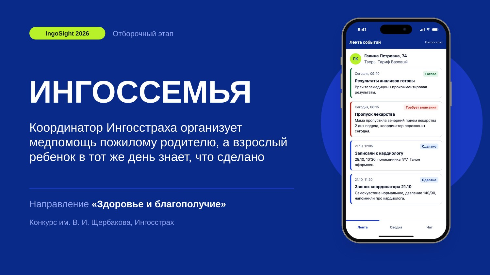

# ИНГОССЕМЬЯ

**Персональный координатор Ингосстраха организует медпомощь пожилому родителю,<br>а взрослый ребенок в тот же день знает, что сделано.**


[](LICENSE)

[Прототип](#-интерфейс) ·
[Презентация](#-презентация) ·
[Экономика](#-экономика) ·
[Ветераны СВО](#-особые-условия-для-ветеранов-сво-и-ветеранов) ·
[MVP](#-план-mvp-и-гипотезы) ·
[Файлы](#-структура-репозитория)

</div>

---

## 💡 Идея в трех фразах

- **Проблема.** Взрослые дети 35–60 лет организуют медпомощь родителю 70+, который живет отдельно. Они звонят каждый день, записывают через Госуслуги, фотографируют рецепты и все равно узнают о проблемах поздно.
- **Пробел на рынке.** Между «справляюсь сам» и «сиделка за 30–72 тыс. ₽ в месяц» сейчас ничего нет.
- **Решение.** Подписка за **2 490 ₽ в месяц**: робот каждый день звонит родителю, координатор Ингосстраха реагирует на сигналы, записывает к врачам и пишет ребенку отчет в мессенджере MAX.

<table>
<tr>
<td align="center" width="25%"><h3>89%</h3>нуждающихся в уходе<br>остаются на семье</td>
<td align="center" width="25%"><h3>в 12–29 раз</h3>дешевле сиделки</td>
<td align="center" width="25%"><h3>+862 ₽</h3>маржинальный доход<br>с семьи в месяц</td>
<td align="center" width="25%"><h3>3,0</h3>LTV / CAC<br>в базовом сценарии</td>
</tr>
</table>

---

## 📱 Интерфейс

Кликабельный прототип: [`06_prototype/Прототип_ИНГОССЕМЬЯ.html`](06_prototype/Прототип_ИНГОССЕМЬЯ.html). Файл открывается в браузере без установки, в нем три режима: телефон ребенка, личный кабинет на компьютере и рабочее место координатора.

> [!TIP]
> Смотреть онлайн: [открыть прототип в браузере](https://htmlpreview.github.io/?https://github.com/mikhail-krainev/ingos-family/blob/main/06_prototype/%D0%9F%D1%80%D0%BE%D1%82%D0%BE%D1%82%D0%B8%D0%BF_%D0%98%D0%9D%D0%93%D0%9E%D0%A1%D0%A1%D0%95%D0%9C%D0%AC%D0%AF.html)

### Мини-приложение для ребенка

<p align="center">
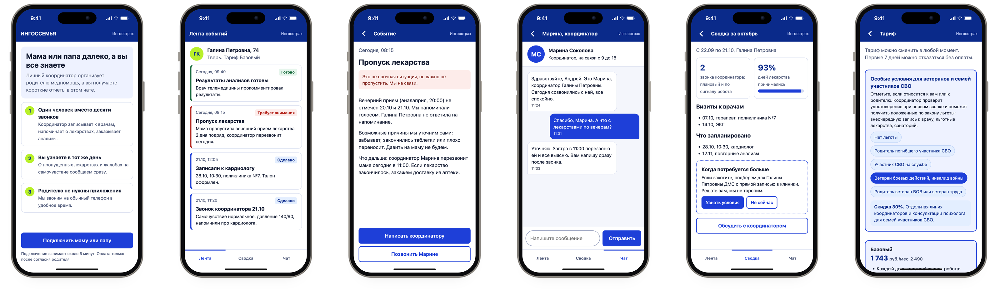
</p>

<p align="center"><sub>Приветствие · Лента событий · Пропуск лекарства · Чат с координатором · Сводка за месяц · Тариф с льготами</sub></p>

### Личный кабинет и рабочее место координатора

<table>
<tr>
<td width="50%">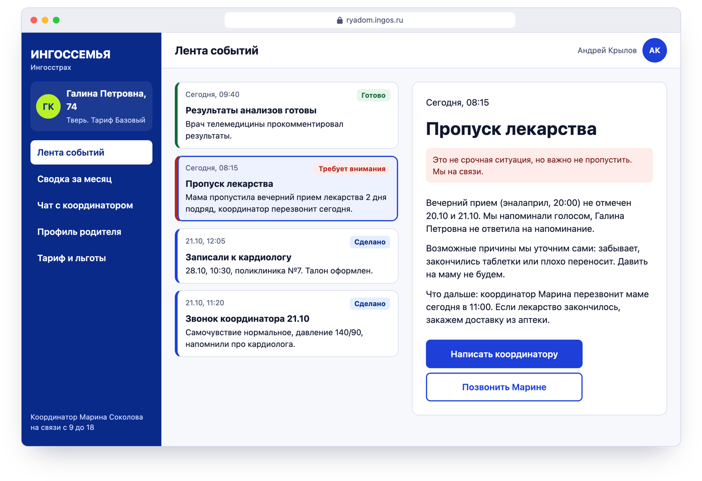</td>
<td width="50%">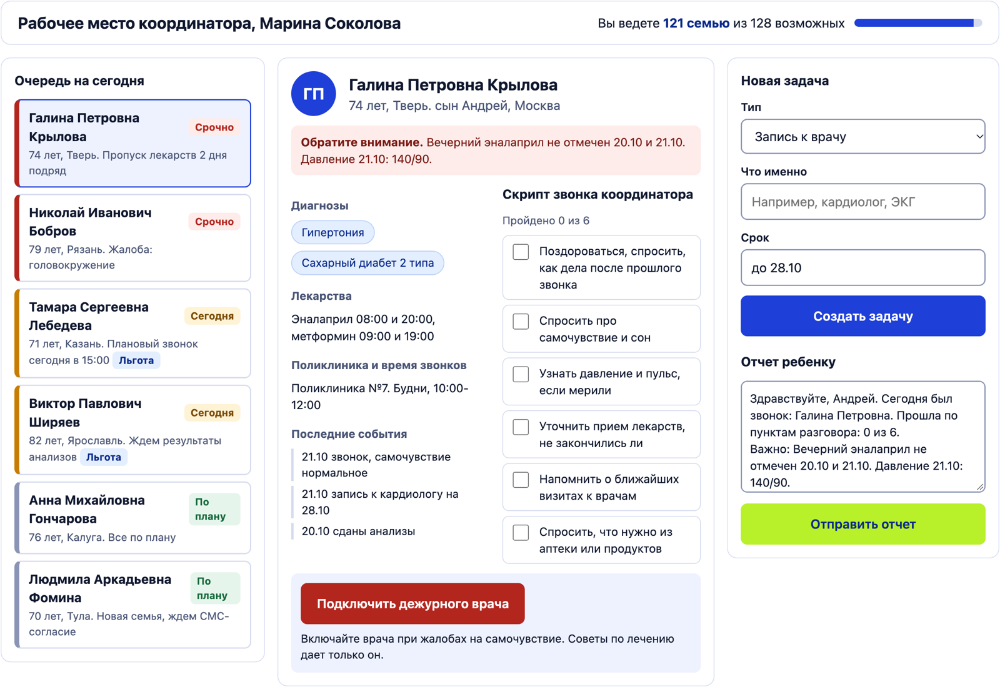</td>
</tr>
<tr>
<td align="center"><sub>Личный кабинет на компьютере</sub></td>
<td align="center"><sub>Координатор ведет 128 семей в одном окне: очередь, скрипт звонка, отчет</sub></td>
</tr>
</table>

---

## 🧭 Как работает сервис

<p align="center">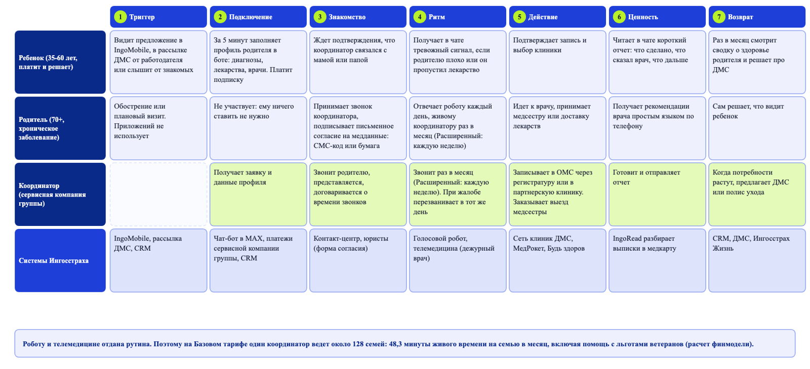</p>

| Шаг | Что происходит | На чем работает |
|:---:|---|---|
| 1 | **Триггер:** обострение или плановый визит родителя | IngoMobile, рассылка ДМС, CRM |
| 2 | **Подключение** за 5 минут в чат-боте MAX | Бот в MAX, платежи |
| 3 | **Знакомство:** координатор звонит родителю, получает согласие (152-ФЗ, ст. 10) | Контакт-центр, юристы |
| 4 | **Ритм:** робот звонит каждый день, человек перезванивает по сигналу | Голосовой робот, телемедицина |
| 5 | **Действие:** запись к врачу, анализы, медсестра, лекарства | Клиники ДМС, МедРокет, «Будь здоров» |
| 6 | **Ценность:** ребенок получает отчет в чате | IngoRead |
| 7 | **Возврат:** ежемесячная сводка, ДМС для родителя, полис ухода | CRM, продукты группы |

<details>
<summary><b>Диаграммы: пользовательский сценарий, блупринт, архитектура, дорожная карта</b></summary>

<br>

**Пользовательский сценарий**
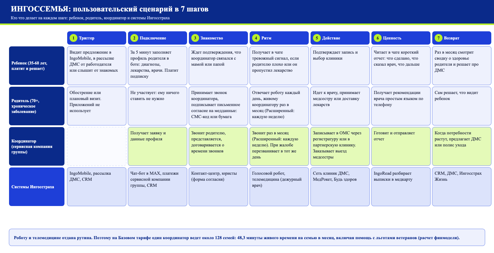

**Сервисный блупринт**
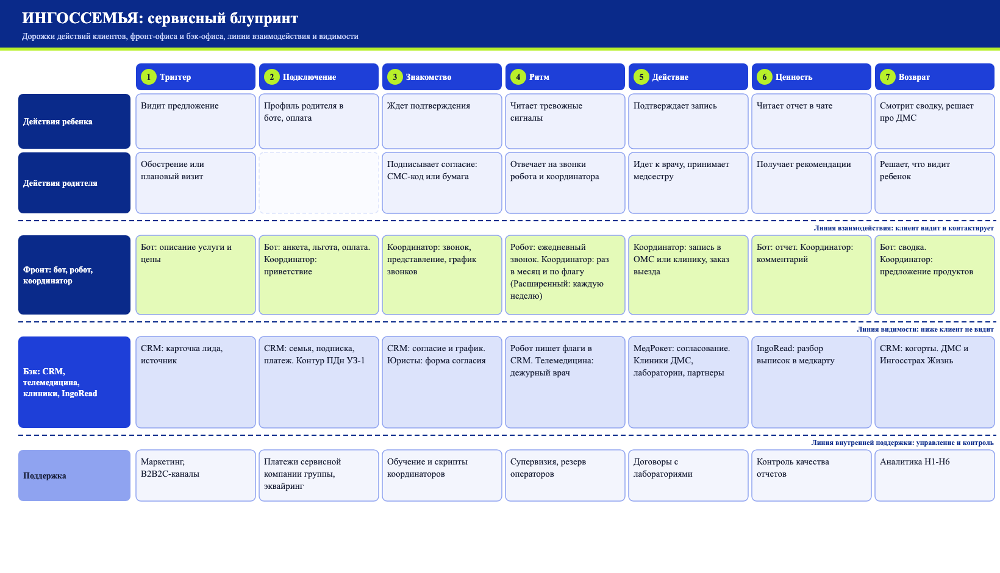

**Архитектура MVP**
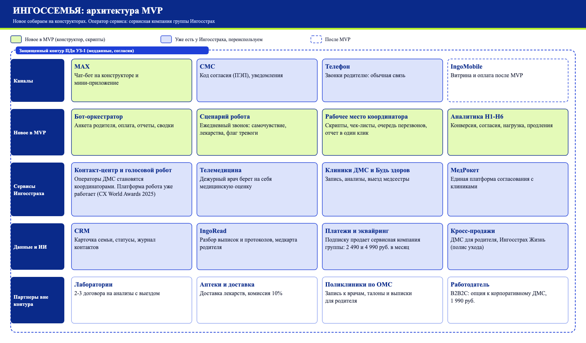

**Дорожная карта MVP**
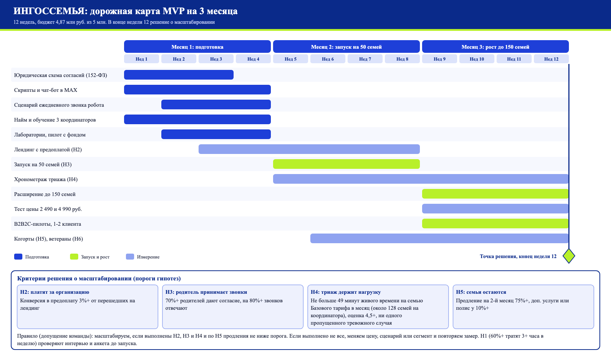

</details>

---

## 🎖 Особые условия для ветеранов СВО и ветеранов

Для семей участников СВО задача острее. Участник на службе не может звонить родителю и приезжать к нему. У родителей погибших участников нет ребенка, который организует помощь.

| Категория | Условие |
|---|:---:|
| Родители погибших участников СВО | **Тариф «Базовый» бесплатно** |
| Участники СВО на службе (оплачивают сервис для родителя) | **−50%** |
| Ветераны боевых действий, включая ветеранов СВО, и инвалиды войны | **−30%** |
| Ветераны ВОВ и ветераны труда (родитель) | **−10%** |

Кроме скидки: координатор помогает получить положенные по закону льготы (внеочередная запись, льготные лекарства), работает отдельная обученная линия, есть психолог, обращения передаются в обе стороны с фондом «Защитники Отечества». Льготы стоят сервису **46,8 млн ₽** недополученной выручки за 60 месяцев, эта сумма уже вычтена из всех расчетов.

<p align="center">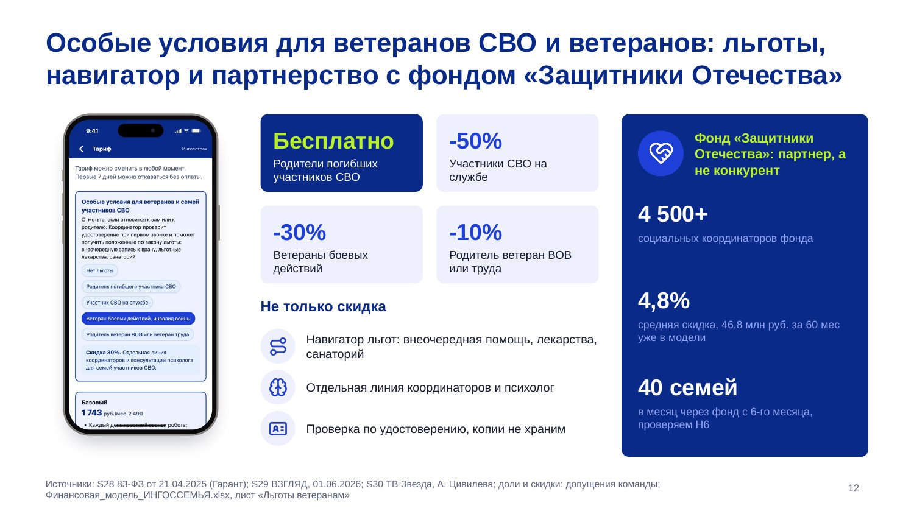</p>

---

## 📊 Экономика

Вся модель собрана в книге Excel на формулах: [`05_finance/Финансовая_модель_ИНГОССЕМЬЯ.xlsx`](05_finance/Финансовая_модель_ИНГОССЕМЬЯ.xlsx). Источник расчетов: [`05_finance/model.py`](05_finance/model.py), итоговые числа: [`05_finance/results.json`](05_finance/results.json).

### Финмодель изменила продукт

Первая версия с живым звонком каждой семье раз в неделю теряла деньги. Версия с ежедневным звонком робота и триажем вышла в плюс.

| Метрика на семью | Версия 1: живой звонок | **Версия 2: робот + триаж** |
|---|:---:|:---:|
| Маржинальный доход, ₽/мес | −515 | **+862** |
| LTV / CAC | −1,78 | **2,99** |
| NPV за 60 мес, млн ₽ | −307,8 | **+23,5** |

<p align="center">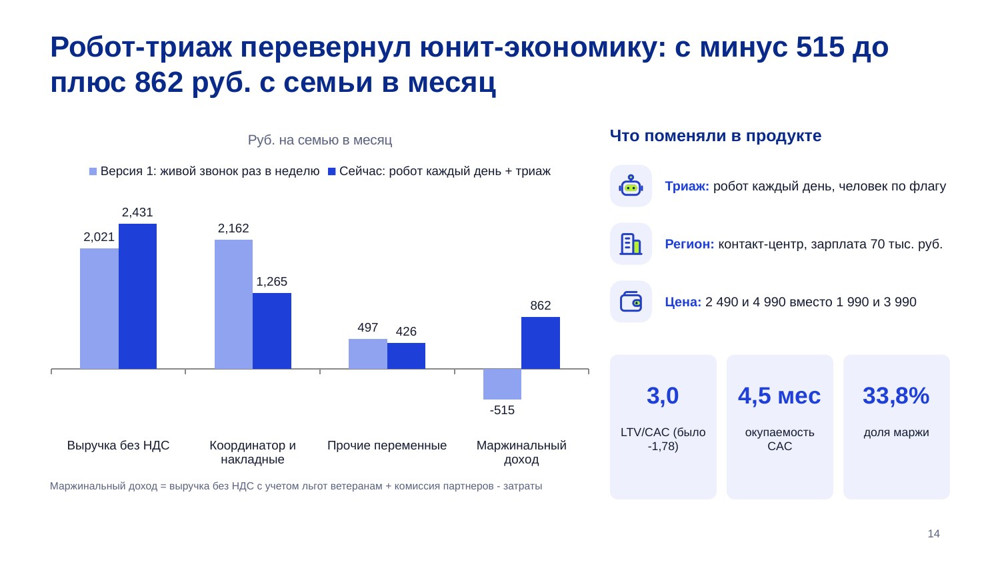</p>

### Юнит-экономика (базовый сценарий)

| ARPU с НДС | Маржинальность | Семей на координатора | CAC | LTV | Окупаемость CAC |
|:---:|:---:|:---:|:---:|:---:|:---:|
| 2 965 ₽ | 33,8% | 128 | 3 896 ₽ | 11 641 ₽ | 4,5 мес |

### Сценарии

| Сценарий | NPV 36 мес | NPV 60 мес | Безубыточность | Окупаемость | Семей через 5 лет |
|---|:---:|:---:|:---:|:---:|:---:|
| Пессимистичный | −89,3 млн ₽ | −133,1 млн ₽ | нет | нет | 5 234 |
| **Базовый** | **−21,1 млн ₽** | **+23,5 млн ₽** | **24 мес** | **43 мес** | **10 654** |
| Оптимистичный | +66,3 млн ₽ | +247,7 млн ₽ | 13 мес | 21 мес | 18 914 |

<sub>NPV до налога. Монте-Карло, 5 000 прогонов: NPV за 60 месяцев положителен в **70,8%** прогонов, за 36 месяцев в 12,7%.</sub>

<table>
<tr>
<td width="50%">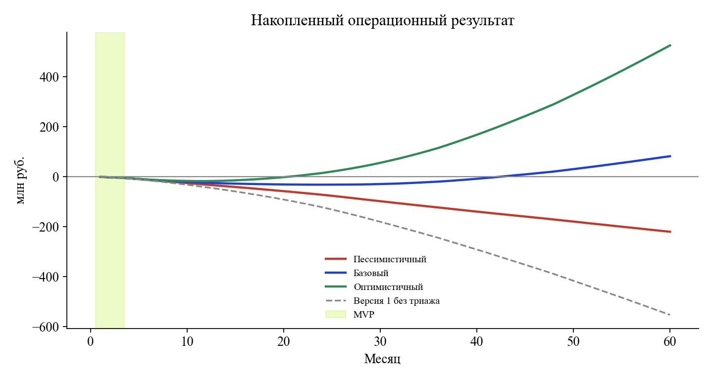</td>
<td width="50%">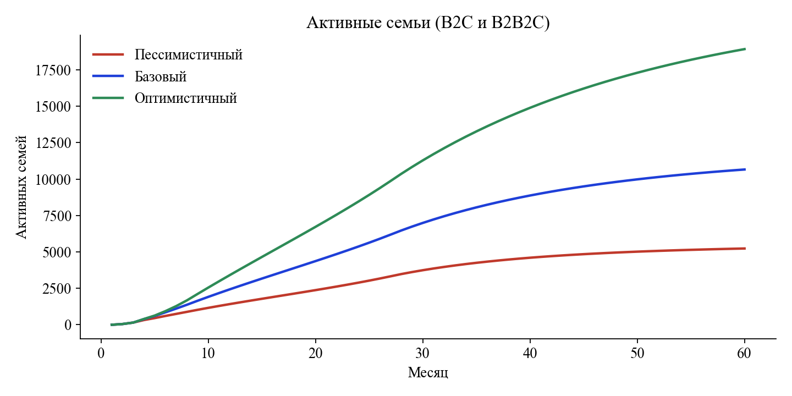</td>
</tr>
<tr>
<td width="50%">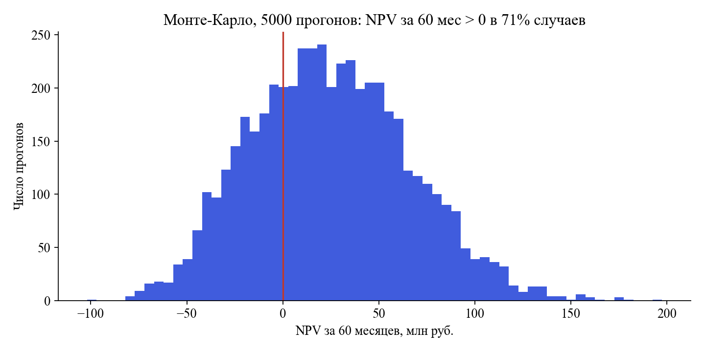</td>
<td width="50%">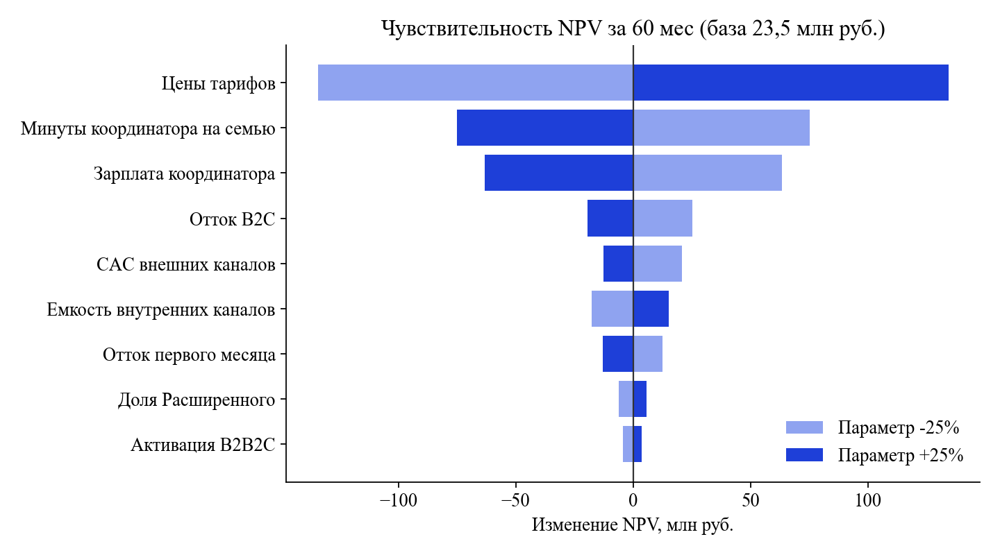</td>
</tr>
</table>

### Рынок

| TAM | SAM | SOM на 60 мес |
|:---:|:---:|:---:|
| 5,85 млн семей · 208 млрд ₽/год | 2,05 млн семей · 72,9 млрд ₽/год | 10,7 тыс. семей · 0,52% SAM |

---

## 🧪 План MVP и гипотезы

**4,87 млн ₽ на 12 недель** (лимит 5 млн ₽, запас 126 тыс. ₽). Проверяем сервис на 150 семьях. Решение о росте принимаем на неделе 12 по порогам гипотез.

<p align="center">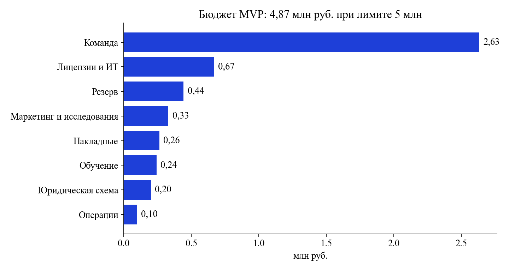</p>

| | Гипотеза | Как проверяем |
|:---:|---|---|
| H1 | Проблема частая и дорогая | Интервью 15+, анкета 150+ |
| H2 | Платят за организацию | Лендинг с предоплатой |
| H3 | Родитель принимает звонки | MVP, 50–150 семей |
| H4 | Триаж держит нагрузку | Хронометраж в MVP |
| H5 | Семьи остаются и покупают еще | Когорты MVP |
| H6 | Семьи ветеранов приходят через фонд | Пилот с фондом |

---

## 🖼 Презентация

Файл: [`08_presentation/Презентация_ИНГОССЕМЬЯ.pptx`](08_presentation/Презентация_ИНГОССЕМЬЯ.pptx), 20 слайдов.

<p align="center">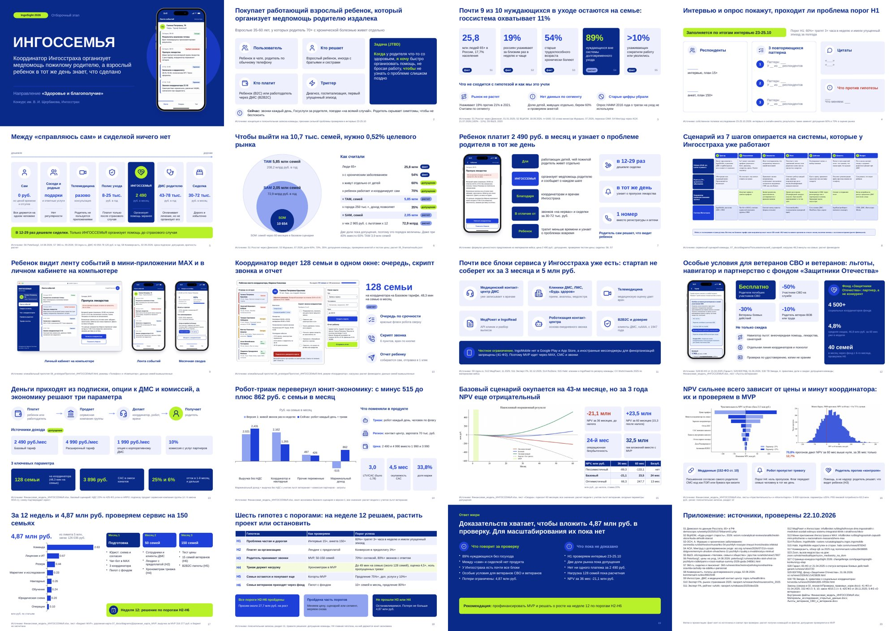</p>

<details>
<summary><b>Ключевые слайды крупно</b></summary>

<br>

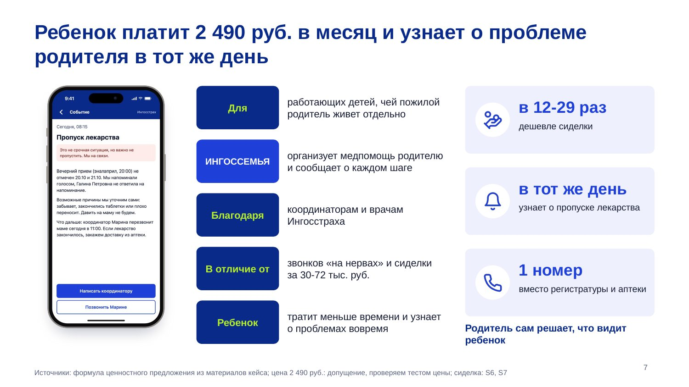
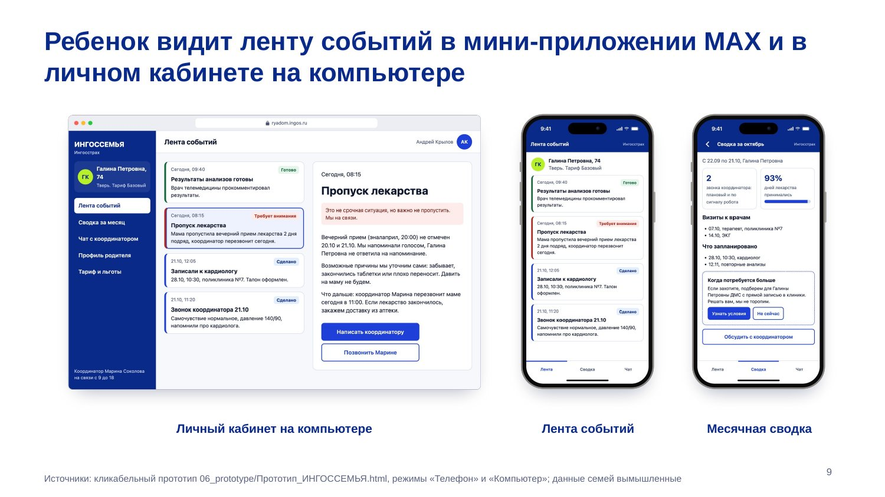
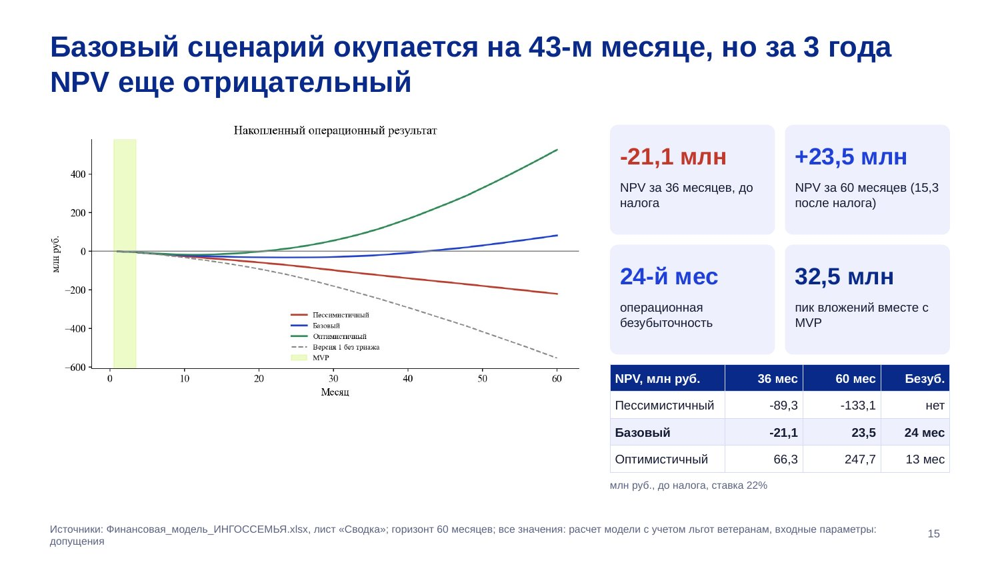
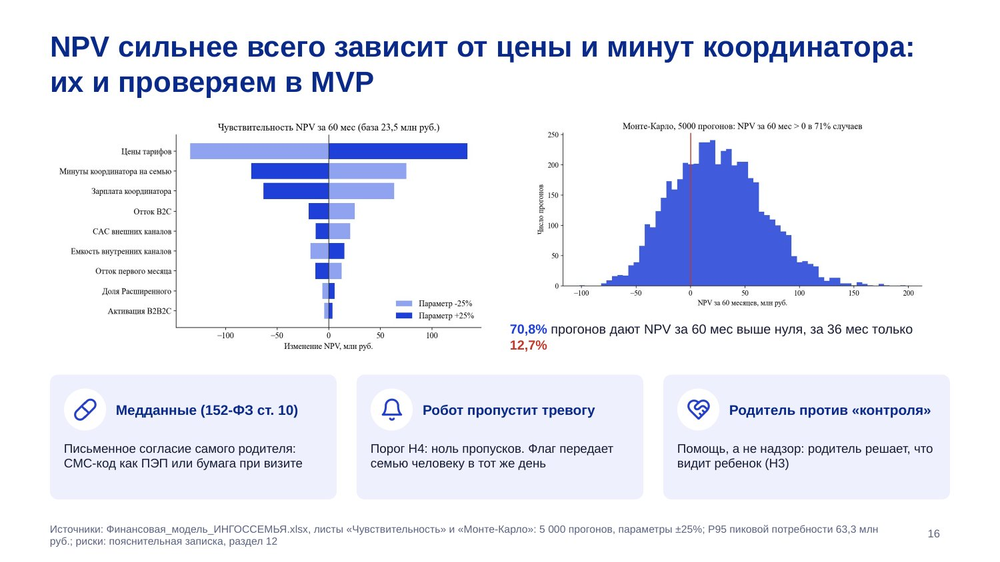
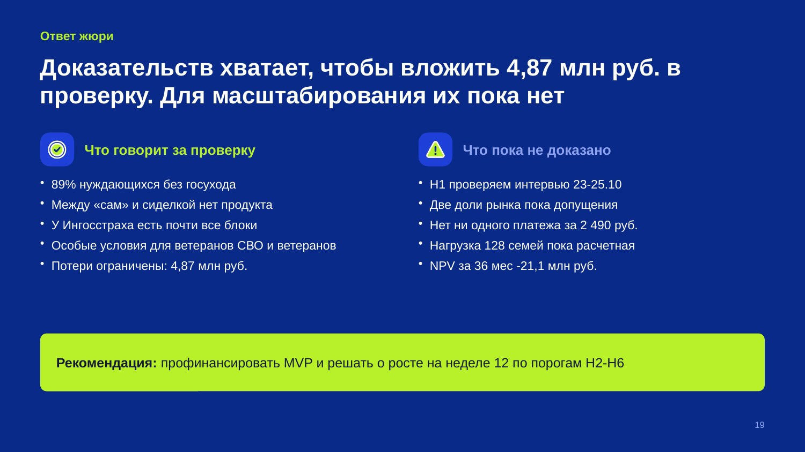

</details>

---

## 📁 Структура репозитория

| Папка | Что внутри |
|---|---|
| [`01_case_materials`](01_case_materials) | Задание кейса, критерии приемки, методички |
| [`02_research`](02_research) | Сегмент, рынок и конкуренты, боли, ресурсы Ингосстраха, льготы ветеранов, правовые нормы, фактчеки |
| [`03_interviews`](03_interviews) | Гайд интервью, анкета, карточка концепции для респондентов |
| [`04_solution`](04_solution) | Концепция продукта |
| [`05_finance`](05_finance) | Финмодель (xlsx на формулах), скрипты расчета, графики |
| [`06_prototype`](06_prototype) | Кликабельный HTML-прототип |
| [`07_docs`](07_docs) | Пояснительная записка, материалы исследования, диаграммы |
| [`08_presentation`](08_presentation) | Презентация и исходники ее сборки |

Обзор проекта и отчет о проверке качества лежат в корне: [`Описание_проекта_и_структура_файлов.docx`](Описание_проекта_и_структура_файлов.docx), [`Отчет_о_проверке_качества_решения.docx`](Отчет_о_проверке_качества_решения.docx).

## 🛠 Как пересобрать

Финансовая модель, графики и `results.json`:

```bash
cd 05_finance && python3 model.py
```

Презентация:

```bash
cd 08_presentation/build_source && npm install && node build.js
```

Подробности сборки: [`Инструкция_по_сборке_презентации.docx`](08_presentation/build_source/Инструкция_по_сборке_презентации.docx).

---

## ⚖️ Авторские права

> [!IMPORTANT]
> **© 2026 Крайнев Михаил Александрович, Кириллов Александр Борисович. Все права защищены.**
>
> Идея, концепция, бизнес-модель и все материалы проекта «ИНГОССЕМЬЯ» являются интеллектуальной собственностью авторов. Использование и реализация проекта, полностью или частично, разрешены только с письменного согласия обоих правообладателей. За нарушение или присвоение наступает ответственность по законодательству РФ, включая требование запрета использования и удаления материалов. Полный текст: [LICENSE](LICENSE).

---

<div align="center">
<sub>Кейс IngoSight 2026 · Конкурс имени В. И. Щербакова · Отборочный этап<br>
Числа помечены как факт, расчет или допущение. Источники перечислены в пояснительной записке.</sub>
</div>
